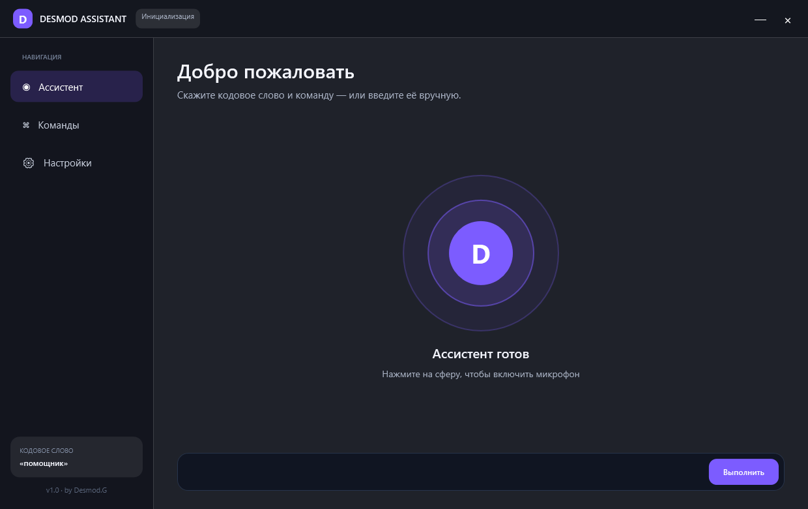

# Desmod Assistant

Нативный голосовой помощник для Windows. Просыпается по кодовому слову, понимает команды, запускает приложения и сайты, делает скриншоты, управляет записью NVIDIA и отвечает голосом.



## Возможности

- постоянное локальное распознавание речи через Windows Speech;
- настраиваемое кодовое слово, по умолчанию — «Помощник»;
- голосовые ответы и выбор установленного голоса Windows;
- резервная строка ручного ввода;
- запуск YouTube и попытка открыть последнее видео указанного канала;
- запуск Dota 2, Steam, CapCut и TLauncher;
- создание снимка всех экранов;
- переключение записи NVIDIA сочетанием Alt+F9;
- открытие сайтов;
- тёмная и светлая темы с плавным переходом;
- собственный фон: PNG, JPG, GIF, MP4 или WMV;
- автозапуск вместе с Windows;
- подтверждение перед выключением или перезагрузкой;
- необязательное подключение API ИИ для свободного диалога;
- анимированная стартовая заставка «Desmod Assistant by Desmod.G».

## Быстрый старт

1. Скачайте архив `DesmodAssistant-win-x64` из раздела **Actions** или **Releases**.
2. Распакуйте архив.
3. Запустите `Desmod.Assistant.exe`.
4. Разрешите Windows доступ к микрофону, если появится запрос.
5. Скажите: «Помощник, открой YouTube».

Для базовых команд интернет и API-ключ не требуются. Для свободных вопросов добавьте совместимый ключ и endpoint во вкладке «Настройки».

## Примеры команд

- «Помощник, открой YouTube»
- «Помощник, открой канал Димы Масленникова и запусти последнее видео»
- «Помощник, открой Доту»
- «Помощник, запусти Steam»
- «Помощник, открой CapCut»
- «Помощник, сделай скриншот»
- «Помощник, запусти запись экрана»
- «Помощник, открой сайт github.com»

Скриншоты сохраняются в `Изображения\Desmod Assistant`.

## Сборка из исходников

Требуется Windows 10/11 и .NET 8 SDK.

```powershell
dotnet restore
dotnet build -c Release
dotnet publish -c Release -r win-x64 --self-contained true -p:PublishSingleFile=true -p:IncludeNativeLibrariesForSelfExtract=true -o publish/win-x64
```

## Приватность и безопасность

- Базовое распознавание речи выполняется средствами Windows.
- API ИИ используется только после добавления пользователем ключа.
- Потенциально опасные системные команды требуют явного подтверждения.
- Приложение не обходит защиту Windows и не получает права администратора автоматически.

## Ограничения версии 1.0

- Качество распознавания зависит от установленного языкового пакета Windows и микрофона.
- Автоматический выбор последнего видео зависит от доступности публичной выдачи YouTube.
- Пути некоторых приложений могут отличаться; в таком случае Windows должна находить приложение по имени.

## Автор

Desmod Assistant by Desmod.G
